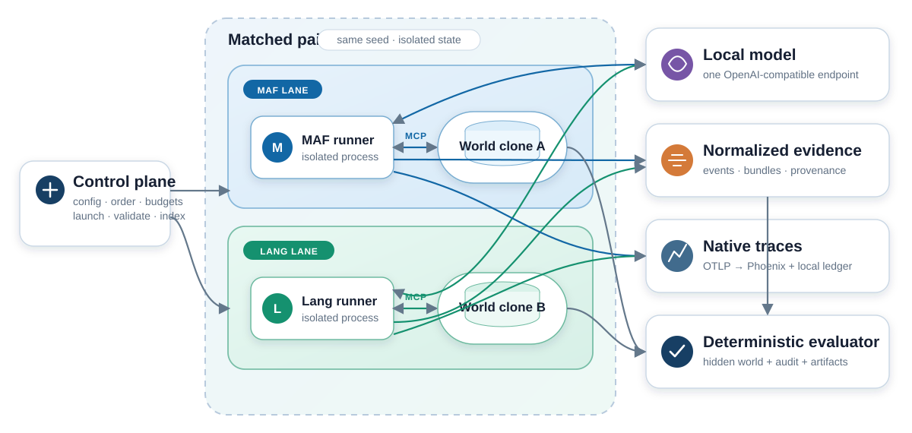

# Agent Framework Field Lab

[](https://github.com/noodlefrenzy/maf_vs_langchain/actions/workflows/ci.yml)
[](LICENSE)
[](https://www.python.org/downloads/)

A controlled field lab for comparing Microsoft Agent Framework with the
LangChain ecosystem while holding the model, task, tools, budgets, and
evaluation rules constant.

The comparison has three matched tracks:

| Question | Microsoft lane | LangChain lane |
| --- | --- | --- |
| How do explicit workflow runtimes compare? | Agent Framework Workflows | Custom LangGraph |
| How do opinionated long-horizon harnesses compare? | Agent Framework Harness | Deep Agents |
| Does role separation add value over one agent? | Agent Framework `Agent` | LangChain `create_agent` |

The primary scenario is a seeded incident-response simulation. Specialized
agents receive role-scoped MCP tools, investigate hidden state, tolerate
transient tool failures, coordinate a diagnosis, and request approval for a
mitigation. Each paired run gets an isolated copy of the same world.



## How to read the numbers in this repository

**Nothing here is a benchmark result.** This repository publishes pilots,
gates, and diagnostics — small-N, descriptive, and preregistered as such. The
success ratios below and throughout the docs are reported so the method can be
audited, not so the frameworks can be ranked.

Specifically, before quoting any figure from this repository:

- **N is small.** The largest cohorts are five scenario seeds by three
  repetitions, giving 15 inference-eligible pairs per arm. Seed-clustered
  bootstrap intervals over 15 pairs are wide; run-level counts are explicitly
  descriptive only.
- **One model, one operating point.** All promoted results use a single pinned
  Qwen3.5-27B Q4_K_M GGUF on local llama.cpp. Framework behavior at this
  capability level need not generalize to frontier hosted models.
- **The harness track is diagnostic, not confirmatory.** Its canonical gate has
  not passed. Harness-lane numbers come from ablations retained as
  stabilization evidence and cannot substitute for that gate.
- **Some asymmetries are deliberate.** Where a framework's native behavior
  cannot be matched without changing what it is, the difference is preregistered
  as behavior under test rather than normalized away. Which are which is
  recorded in [the comparison protocol](docs/comparison-protocol.md) and the
  [ADRs](docs/adr/README.md).

If you want a single sentence: this is a study of whether these frameworks can
be compared fairly at all, and the apparatus for doing so, with early
observations attached.

> This project is not affiliated with, endorsed by, or sponsored by Microsoft or
> LangChain. "Microsoft Agent Framework", "LangChain", "LangGraph", and all
> other marks belong to their respective owners and are used here only to
> identify the software under comparison.

## Quickstart

The core skeleton runs without either agent framework and without a downloaded
model:

```bash
uv sync
uv run agent-lab scenario generate --seed 42
uv run agent-lab config validate configs/experiments/smoke.toml
uv run pytest
```

From there, [Running experiments](#running-experiments) covers the protocol
probe, the paired smokes, the observer, and report building.

## Repository layout

Framework runners and the MCP service are deliberately separate uv projects:

```text
src/agent_lab/          Framework-neutral control plane, contracts, scorer, reports
runners/maf/            Microsoft Workflows, Harness, and Agent adapters
runners/langgraph/      LangGraph, Deep Agents, and create_agent adapters
services/incident_mcp/  Seeded incident world exposed through MCP
configs/                Experiment, model, case, and study profiles
docs/                   Spec, architecture, ADRs, and research records
```

This separation is part of the experiment design, not ceremony: framework
instrumentation and MCP SDK versions can conflict, and every lane must be
observable and restartable as its own process. The root project has zero
framework dependencies, so neutrality is enforced at the packaging layer.

Dependency changes must use the rolling 72-hour release quarantine documented
in [`docs/dependency-quarantine.md`](docs/dependency-quarantine.md). The
project-owned lock command covers all four isolated uv projects, and CI
verifies the policy before installing anything.

## Results so far

Read [How to read the numbers](#how-to-read-the-numbers-in-this-repository)
first. Everything below is descriptive.

### Model qualification

| Candidate | Runtime | Outcome |
| --- | --- | --- |
| Qwen3.5-9B | vLLM | **Fit-check only.** Two corrected task-quality gates: the first had one LangGraph success and one valid MAF evidence-gate failure, the second reversed the split, with MAF succeeding while LangGraph completed without effective containment or recovery. Neither pair had two successful lanes. |
| Qwen3.5-27B Q4_K_M GGUF | llama.cpp | **Promoted.** Cleared both restart characterizations, the full MAF/LangChain compatibility suite, and a paired task-quality gate with two successful lanes. This exact operating point is used for the five-seed pilots. See the [accepted gate](docs/research/qwen35-27b-llamacpp-gate.md). |
| Qwen3.5-35B-A3B GPTQ-Int4 | vLLM | **Rejected.** Tested at 16K/8 GiB and at a minimal 8K/2 GiB offload point. Both loaded all weights but failed during vLLM engine initialization because Triton kernels received CPU-offloaded tensors. A no-offload configuration cannot leave useful KV-cache headroom on a single 4090. See the [failed gate](docs/research/qwen35-35b-a3b-gate.md). |

The accepted profile leaves only about 1.3 GiB of whole-device GPU margin, so
measured execution prohibits concurrent non-study GPU workloads.

### Single-agent track

Five scenario seeds by three repetitions. Both pilots retained all 30 valid
bundles and 15 inference-eligible pairs.

| Pilot | MAF `Agent` | LangChain `create_agent` |
| --- | --- | --- |
| Compute-matched | 3/15 | 11/15 |
| Unrestricted | 3/15 | 11/15 |

The unrestricted cohort's observed maxima remained below the lower
compute-matched ceilings, so it supplies no budget-rescue evidence. Full record:
[single-agent pilots](docs/research/qwen35-27b-single-agent-pilots.md).

### Opinionated harness track

**The canonical harness gate has not passed.** Everything below is a
preregistered sensitivity diagnostic that changes exactly one shared control
while freezing seeds, repetitions, budgets, and fault schedule. None of it
qualifies the gate. Each retained all 30 valid bundles and 15 inference-eligible
pairs.

| Diagnostic | Control changed | MAF Harness | Deep Agents | Note |
| --- | --- | --- | --- | --- |
| [Two-turn correction](docs/research/qwen35-27b-harness-correction-two-diagnostic.md) | Provenance correction → 2 turns | 4/15 | 7/15 | The extra turn also triggered outer/native call limits. |
| [Zero-turn correction](docs/research/qwen35-27b-harness-correction-zero-diagnostic.md) | Provenance correction → 0 turns | 2/15 | 3/15 | Sparse outcomes and 6 retained operational failures: removing correction does not resolve the model-quality problem. |
| [Paraphrase A](docs/research/qwen35-27b-harness-paraphrase-a-diagnostic.md) | Shared prompt wording | 0/15 | 4/15 | 15 retained failures across the lanes. Prompt wording is a material treatment variable at this operating point. |
| [No review](docs/research/qwen35-27b-harness-no-review-diagnostic.md) | Reliability reviewer removed | 1/15 | 1/15 | Equal successes, very different completion behavior: 2/15 operational failures for MAF against 13/15 for Deep. |
| [No compaction](docs/research/qwen35-27b-harness-no-compaction-diagnostic.md) | Native context compaction disabled | 0/15 | 4/15 | 3/15 operational failures for MAF against 1/15 for Deep. Closes the planned sensitivity set. |

### Supporting studies

| Study | Finding |
| --- | --- |
| [Native tracing overhead](docs/research/native-tracing-overhead.md) | A balanced 16-launch ablation measured a consistent fixed control-path cost: median paired increases of 134 ms for MAF and 423 ms for LangGraph, including only 6–7 ms of explicit trace flush. Native tracing stays enabled for measured pilots. |
| [Run observability](docs/research/run-observability-validation.md) | Validates the versioned per-call, host/GPU, and control-plane ledgers. |
| [Neutral observer](docs/research/neutral-observer-validation.md) | A clean interactive pair validated discovery, approval, completion, and exact-cursor replay. |
| [Production checkpoints](docs/production-checkpoints.md) | Cosmos DB is the selected production-intended checkpoint substrate for both explicit lanes. Both provider adapters passed a pinned emulator restart gate; real Azure deployment acceptance remains separate. |

The measured-study protocol is machine-readable and CI-validated but remains
fail-closed pending an accepted-model pilot, a computed sample size, and
reviewer approval. See
[measured-study-preregistration.md](docs/measured-study-preregistration.md).

## Implementation status

The v0.1 design is approved and implementation is underway.

**Working end to end:**

- Frozen shared prompt/tool/schema bundle; stateful, auditable incident
  simulator; approval-gated mitigation and recovery semantics; deterministic
  scorer; authenticated Streamable HTTP service for isolated paired world clones.
- A control plane supplying a typed runner protocol, isolated run paths,
  deterministic lane ordering, outer lifecycle and budget enforcement, native
  MAF/LangGraph process handlers, and a mock failure matrix.
- **Explicit track:** matched native MAF/LangGraph workflows through
  investigation, commander synthesis, evidence gating, native approval
  checkpoints, token-bound mitigation, and recovery verification — executing
  through the normalized runner protocol with pre-dispatch usage, portable
  model/tool and approval events, control-plane decisions, and owner-only
  terminal state.
- **Opinionated track:** MAF Harness background agents and declarative Deep
  Agents subagents performing native role-scoped delegation through a shared
  evidence gate into the same approval, execution, finalization, scoring, and
  pair-validation path. MAF Harness metering sits below its internal
  function-invocation loop, so every provider dispatch — including tool-loop
  iterations — consumes the shared outer budget.
- **Single-agent track:** one model-driven commander per lane, a duplicate-free
  union discovery catalog, strict source-endpoint evidence provenance, and the
  same outer approval/recovery boundary.
- Correlated, redacted native span ledgers with best-effort export to a pinned
  loopback Phoenix deployment, and validated operation-level trace completeness
  that does not make collector availability run-critical.
- Finalization into the five frozen incident artifacts, deterministic scores,
  individually validated bundles, and a persistent paired experiment with
  pair-level provenance validation. Bundles are checkable with
  `agent-lab bundle validate` and `agent-lab bundle validate-pair`.

**Known limitations:**

- Harness state is process-local and non-resumable.
- The canonical harness task-quality gate has not passed.
- Smoke runs exercise the system but are not benchmark evidence.

## Running experiments

### Protocol probe — no model required

Exercise the four multi-agent lanes' process boundary without loading a model:

```bash
uv run agent-lab experiment probe \
  --experiment configs/experiments/smoke.toml \
  --runs-dir runs \
  --order-seed 1729
```

This resolves the profile, creates verified paired world clones, starts the
authenticated loopback MCP service, records lane order, launches each native
runner sequentially, enforces outer limits, and persists protected world
checkpoints and terminal bundles. It is explicitly a protocol probe: no model
or MCP tool is called, no score is produced, and its bundles are not benchmark
evidence.

### Paired smokes — against a local endpoint

Each of these invokes the model and MCP tools against the configured local
OpenAI-compatible endpoint, writes scored bundles, validates each bundle and
the pair, and saves a summary index. Summary `status = "ok"` means execution
and provenance succeeded; task success remains a separate per-run score field.

```bash
# Explicit workflows — MAF Workflows vs LangGraph
uv run agent-lab experiment run \
  --experiment configs/experiments/explicit-smoke.toml \
  --runs-dir runs --order-seed 1729

# Opinionated harness — MAF Harness vs Deep Agents
uv run agent-lab experiment run \
  --experiment configs/experiments/harness-smoke.toml \
  --runs-dir runs --order-seed 1737

# Single agent — MAF Agent vs LangChain create_agent
uv run agent-lab experiment run \
  --experiment configs/experiments/single-agent-compute-matched-smoke.toml \
  --runs-dir runs --order-seed 1741
```

The explicit smoke uses the declared scripted `approve` policy without
correcting the model's action.

The harness smoke verifies every accepted specialist against its actual
role-scoped MCP calls and exact evidence IDs. See
[`docs/gotchas.md`](docs/gotchas.md) for framework-specific stopping and
structured-output behavior observed with the local model.

The single-agent smoke gives each lane exactly one model-driven incident
commander and the same duplicate-free union of capability-scoped discovery
tools. Source-role labels preserve MCP evidence provenance and do not represent
delegated agents. Both adapters use the same two phases: unstructured MCP
discovery must satisfy a two-source gate, then a tool-disabled structured turn
synthesizes only from the observed source-specific evidence allowlist. Each
phase has the same eight-dispatch local model-call ceiling, beneath the shared
outer run budget.

### Live compatibility probe

To exercise both adapters against a live loopback model without creating
benchmark evidence:

```bash
uv run --project services/incident_mcp --no-sync \
  incident-lab-single-agent-compat \
  --model '<model-id-advertised-by-the-endpoint>'
```

The probe uses twin seeded worlds, deliberately edits approval to the known
recovery action, requires both lanes to recover, and validates both bundles and
their pair. It uses greedy compatibility sampling, verifies that per-role and
protocol model/tool/output accounting agree, and marks its output
`measurement_eligible: false`.

### Watching runs

Watch paired bundles live or replay completed evidence through the neutral
loopback observer:

```bash
uv run agent-lab observer serve --runs-dir runs
```

It provides a two-column browser timeline, sequence-addressable SSE, Phoenix
and artifact links, an equivalent Rich renderer, and optional authenticated
local approval controls — without rendering raw model reasoning. See
[neutral-observer.md](docs/neutral-observer.md).

### Pilot and ablation profiles

The clean-source Qwen3.5-9B sequence is preregistered as a one-seed
task-quality gate followed by separately executable pilot profiles. The larger
profiles are not promoted when either task-quality-gate lane fails to complete
successfully.

```text
configs/experiments/qwen35-9b-task-quality-pilot.toml
configs/experiments/explicit-pilot.toml
configs/experiments/harness-pilot.toml
configs/experiments/single-agent-compute-matched-pilot.toml
configs/experiments/single-agent-unrestricted-pilot.toml
```

Harness sensitivity profiles freeze the same seeds, repetitions, budgets, and
fault schedule while changing exactly one shared prompt, correction,
role-topology, or native-compaction control:

```text
configs/experiments/harness-correction-zero-ablation.toml
configs/experiments/harness-correction-two-ablation.toml
configs/experiments/harness-paraphrase-a-ablation.toml
configs/experiments/harness-no-review-ablation.toml
configs/experiments/harness-no-compaction-ablation.toml
```

The effective prompt/policy payload is hashed into both paired manifests and
the pair preflight. Both native adapters consume the same validated
`harness_ablation` request object; supported provenance-correction counts are
zero, one, and two turns. The same object can remove the reliability reviewer
from both lanes or disable both frameworks' native context compaction; active
roles and compaction mode are frozen into the effective normalized topology.

All pilot and ablation profiles share the equal-weight, five-family case
manifest in `configs/cases/pilot-v1.json`. Resolve their runner support,
contract preflights, cases, and balanced per-block lane order without starting
services via `agent-lab experiment plan`; the frozen selection and command are
documented in [`docs/pilot-case-plan.md`](docs/pilot-case-plan.md).

> **Measured execution refuses a dirty Git worktree.** Commit the reviewed
> source freeze before running these profiles. Protocol probes remain
> explicitly non-measurement evidence.

### Building reports

After one or more native profiles finish, build a fail-closed offline report
from their immutable summary indices:

```bash
uv run agent-lab report build \
  --index runs/native-workflow-explicit_workflow_pilot_v1-order-1729.json \
  --index runs/native-workflow-opinionated_harness_pilot_v1-order-1729.json \
  --output-dir reports/pilot-v1
```

The command revalidates every individual bundle and pair, preserves the frozen
left/right lane order, retains operational failures in denominators, and emits
portable `paired-report/v3` JSON plus self-contained HTML.

Statistically, the primary binary effect averages repetitions within each
scenario seed, bootstraps seed clusters, applies a paired sign-flip
randomization test, and reports Holm adjustment when both confirmatory tracks
are present. Run-level McNemar counts remain explicitly descriptive. Paired
effects also cover scores, task/control latency, calls, all reported token
dimensions, provider queue/TTFT/generation time, client concurrency, GPU/host
samples, and native trace coverage. Continuous effects include deterministic
paired-bootstrap intervals over seed clusters; scorer components report their
observed discrimination per lane.

> **The output directory is owner-only.** It contains redacted source/run
> evidence, fresh individual and pair validations, a complete private copy of
> each source bundle, and a SHA-256 inventory. Do not publish the
> `private-runs/` subtree; follow
> [the retention procedure](docs/evidence-retention.md).

## Documentation

**Design and method**

| Document | Contents |
| --- | --- |
| [SPEC.md](docs/SPEC.md) | The experiment specification. Start here. |
| [architecture.md](docs/architecture.md) | System architecture and trust boundaries. |
| [comparison-protocol.md](docs/comparison-protocol.md) | What is held constant, and what is deliberately not. |
| [contracts-v0.1.md](docs/contracts-v0.1.md) | The frozen v0.1 contract bundle. |
| [ADRs](docs/adr/README.md) | Accepted architectural decisions, including reversals. |
| [metrics.md](docs/metrics.md) · [run-bundle.md](docs/run-bundle.md) · [runner-protocol.md](docs/runner-protocol.md) | Measurement, evidence, and process-protocol formats. |

**Before changing an adapter**

| Document | Contents |
| --- | --- |
| [gotchas.md](docs/gotchas.md) | Framework-specific behavior observed in practice. Read this first. |
| [explicit-workflow-parity.md](docs/explicit-workflow-parity.md) | How the explicit lanes are kept matched. |
| [dependency-quarantine.md](docs/dependency-quarantine.md) | The 72-hour release quarantine policy. |

**Background and review**

| Document | Contents |
| --- | --- |
| [framework-landscape.md](docs/research/framework-landscape.md) · [task-options.md](docs/research/task-options.md) | Research summary and task selection. |
| [local-inference.md](docs/research/local-inference.md) | Local inference stack selection. |
| [findings.md](docs/findings.md) · [REVIEW.md](docs/REVIEW.md) | Running findings and design review. |
| [claude_repo_review.md](docs/claude_repo_review.md) · [claude-review-resolution.md](docs/claude-review-resolution.md) | A full external repository review and the ledger closing out every finding. |
| [diagrams/](docs/diagrams/) | Architecture and workflow diagrams (SVG + Mermaid source). |

Implementation is tracked on the
[project board](https://github.com/users/noodlefrenzy/projects/21); the original
design review is [issue #10](https://github.com/noodlefrenzy/maf_vs_langchain/issues/10).

## Contributing

See [CONTRIBUTING.md](CONTRIBUTING.md). The change rules there are not
boilerplate: this project treats experiment validity as a product requirement,
so paired-lane symmetry, contract versioning, and evidence retention are
reviewed as carefully as correctness.

If you believe the harness treats the two lanes unequally, that is the most
valuable issue you can file. Use the comparison-validity issue template.

## Security

Everything in this repository is loopback-only by design and is not hardened for
network-facing use. To report a vulnerability privately, and to see what is
explicitly out of scope, read [SECURITY.md](SECURITY.md).

## License

[MIT](LICENSE) © Michael Lanzetta.

The license covers the code and documentation in this repository. It does not
cover the frameworks under comparison, the models used to produce results, or
any model weights — each carries its own terms.
