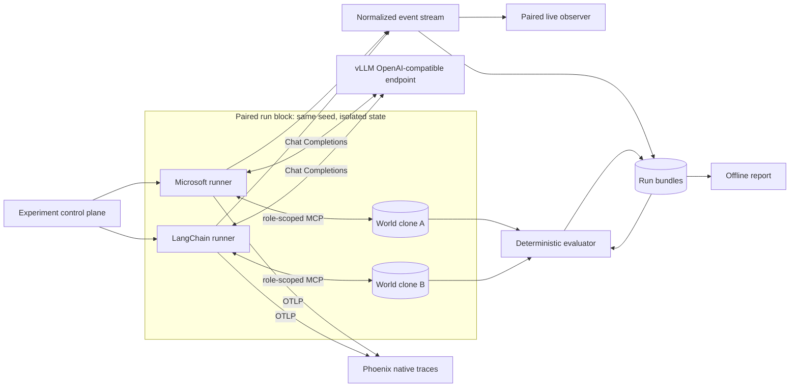
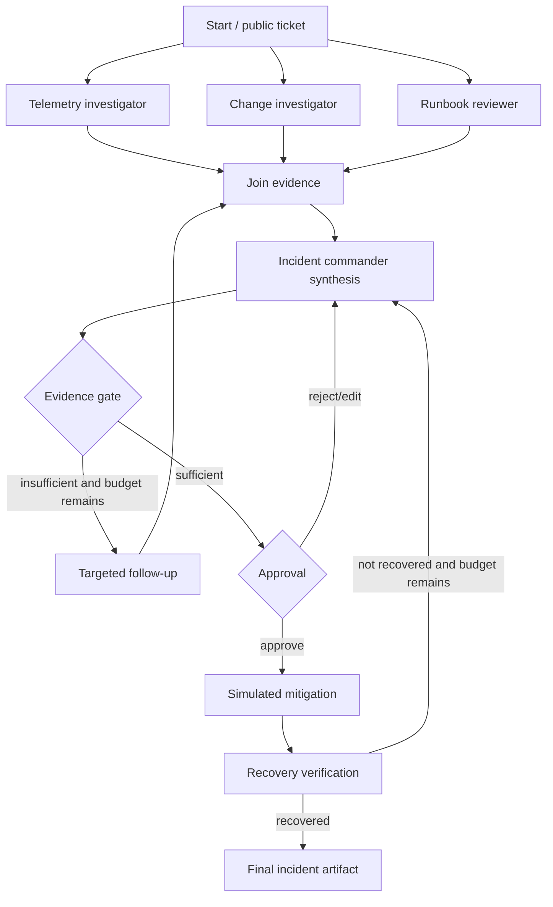
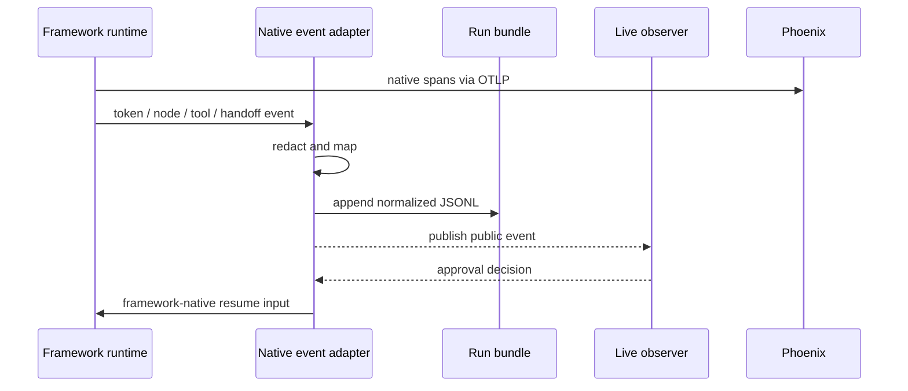

# Architecture

## System context

The lab separates the model, world, runners, observation, and evaluation so
each can be controlled and audited independently.



The two runners do not execute concurrently during measured trials because
they share one GPU. “Paired” means matched within a randomized block, not
simultaneous model requests. The live observer can still compare the current
run against a replay of its matched partner or show simultaneous executions
during a non-measured demo.

## Deployable processes

| Process | Responsibility | Trust boundary |
| --- | --- | --- |
| Control plane | Resolve config, randomize order, launch lanes, enforce budgets, index bundles | May see manifests, not hidden answers |
| vLLM | Serve one pinned local model and expose request/usage metrics | Sees model messages and tool schemas |
| Incident MCP | Own hidden world, role authorization, simulated time/faults/actions | Only component that reads ground truth |
| MAF runner | Build Workflows/Harness, call model/MCP, normalize events | Never reads evaluator state |
| LangGraph runner | Build LangGraph/Deep Agents, call model/MCP, normalize events | Never reads evaluator state |
| Observer | Render normalized public events and approvals | Sensitive capture disabled by default |
| Phoenix | Receive framework-native OTLP traces | Loopback-only local data store |
| Evaluator | Compare final state/artifacts with ground truth and write scores | Runs after or outside agent execution |
| Report builder | Join paired bundles and compute statistics | Read-only over completed bundles |

## Runner boundary

Every runner implements the same conceptual interface:

```python
class Runner(Protocol):
    async def prepare(self, request: RunRequest) -> PreparedRun: ...
    async def stream(self, prepared: PreparedRun) -> AsyncIterator[NormalizedEvent]: ...
    async def respond_to_approval(
        self, run_id: UUID, decision: ApprovalDecision
    ) -> AsyncIterator[NormalizedEvent]: ...
    async def cancel(self, run_id: UUID, reason: str) -> None: ...
```

Framework-native objects do not cross the process boundary. A prepared run
returns a framework-neutral topology description, effective prompt hashes,
tool catalog hashes, and checkpoint capability metadata.

The implemented v0.1 process boundary is the typed JSON-lines protocol
documented in [runner-protocol.md](runner-protocol.md). Requests pass
credentials over stdin, persist only a redacted request view, and expose
workspace/checkpoint/state/trace paths while keeping the service-owned world
directory outside the runner message and environment.

## Matched explicit workflow

The workflow track uses the same logical graph in both runtimes:



The graph's deterministic nodes, conditions, retry ceilings, and data schemas
are equivalent. Framework-native state/checkpoint/event implementations remain
untouched and are part of the comparison.

## Matched harness

Both harnesses get:

- the same commander domain prompt;
- the same configured specialist set and descriptions (three normally, or the
  same telemetry/change pair in the no-review ablation);
- the same per-role MCP tools;
- the same writable artifact directory shape;
- the same context and output budgets;
- the same structured completion contract;
- an outer watchdog enforcing shared limits.

Built-in harness instructions, planning mechanics, subagent protocol, and
filesystem abstractions remain native. Compaction is native in the primary
profile and can be disabled through one matched ablation control. Effective
roles, compaction mode, prompts, and tool catalogs are captured for later
interpretation.

## MCP world isolation

Development supports role-specific stdio catalogs. The paired-run substrate
mounts one role-authenticated Streamable HTTP endpoint per run and role in a
loopback-only service, with:

- an HMAC-signed, expiring run/lane/role bearer credential;
- one server-owned, lock-serialized world and audit log per run;
- role claims that determine the visible tool catalog;
- a world manifest initialized from the paired seed;
- explicit simulated time advanced by calls/actions;
- seeded transient-failure scheduling;
- an append-only server audit log;
- no host filesystem or network tools.

The service currently creates world A and B from the same generated manifest,
validates their manifest digests, and emits different endpoint credentials for
each runner. The control-plane milestone will own that lifecycle and pass only
the appropriate credentials to each runner.

## Event flow and ordering

Each runner consumes native streaming APIs and emits `NormalizedEvent`
envelopes. Sequence numbers are assigned at the runner-side bundle writer in
observation order. Timestamps support human timelines but do not establish
cross-process causality; trace/span IDs and explicit parent IDs do.



Native telemetry and normalized events are complementary:

- native spans answer framework-specific debugging questions;
- normalized events answer paired comparison and scoring questions.

## Live observer

The implemented observer is a local FastAPI service plus a small web client:

- Server-Sent Events for append-only event delivery;
- bearer-authenticated loopback POST for approval/control messages;
- two synchronized lane columns;
- topology, evidence, tool, budget, and state projections;
- deep links into Phoenix and local artifacts;
- replay mode over completed `events.jsonl`;
- no direct connection to model or MCP services;
- event-kind payload allowlisting that drops raw text, arbitrary extensions,
  and every non-public event.

A Rich renderer consumes the same sanitized pair API for SSH/headless use, but
the browser view is primary because side-by-side temporal comparison and
drilldown benefit from screen space. Both lane bundles and their shared live
discovery context are allocated before ordered execution begins. Interactive
decisions cross an owner-only file inbox into the existing control-plane
approval handler and remain bounded by the run deadline.

## Post-hoc pipeline

```text
run bundles
  -> schema/provenance validation
  -> deterministic per-run scoring
  -> pair join by (track, seed, repetition)
  -> derived coordination/resource/trace measures
  -> paired statistics and plots
  -> self-contained HTML report
```

The report builder fails closed when bundle schemas, prompt/tool hashes, model
digests, or budgets differ unexpectedly within a pair.

## Dependency isolation

The root package contains only shared Pydantic contracts, configuration,
scenario generation, and run-bundle utilities. MAF, LangGraph, and MCP service
dependencies live in independent `uv` projects and processes.

This prevents:

- incompatible MCP SDK constraints from contaminating the environment;
- one framework's auto-instrumentation from patching the other;
- accidental imports of framework-native types into the canonical schema;
- a crash or global event loop setting in one runner from affecting its pair.

Each subproject receives and commits its own lock file before measured runs.

## Failure handling

| Failure | Required behavior |
| --- | --- |
| Model timeout/5xx | Runner records the attempt; retry only under explicit shared policy |
| MCP transient error | Visible to the agent and event stream; agent/framework may recover |
| Invalid tool arguments | MCP returns a stable validation error; counts against budget |
| Runner crash | Control plane preserves bundle and attempts checkpoint resume once |
| Approval timeout | Run pauses, then ends as `approval_timeout` at experiment deadline |
| Budget exhausted | Outer guard cancels cleanly and evaluator scores partial work |
| Observer disconnect | Run continues; observer replays from last sequence |
| Phoenix unavailable | Normalized evidence continues; native-trace coverage is marked missing |

## Security posture

This is a local simulator, but it follows production-like boundaries:

- no shell, arbitrary SQL, arbitrary filesystem, or live infrastructure tools
  in the primary benchmark;
- loopback binding for model, observer, MCP, and Phoenix;
- role credentials are run-scoped;
- evaluator/ground truth is never mounted into runners;
- approval precedes all state-changing MCP tools;
- normalized telemetry is redacted and raw reasoning is prohibited;
- containers/processes run without unnecessary host mounts.
