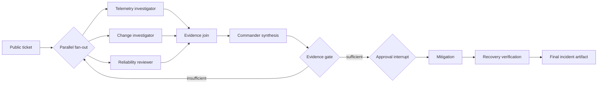

# Microsoft Agent Framework vs the LangChain stack: findings

Status: engineering findings from smoke, stabilization, tracing-ablation,
instrumentation-verification, and adapter-contract hardening through
2026-08-04. This is not a measured benchmark or a framework ranking.

## Executive summary

The most important finding is that “Microsoft Agent Framework versus
LangChain” is not one comparison. The useful comparisons are between matching
layers:

| Comparison layer | Microsoft stack | LangChain stack |
| --- | --- | --- |
| Model/tool agent primitive | Agent Framework `Agent` and chat clients | LangChain `create_agent` and chat models |
| Explicit orchestration | Agent Framework Workflows | LangGraph |
| Opinionated multi-agent harness | Agent Framework Harness | Deep Agents |
| Native telemetry | MAF OpenTelemetry spans | LangGraph/LangChain events plus OpenInference spans |

Within the explicit-workflow track, equivalent topology produced equivalent
task outcomes in the current smoke scenario. Three traced pair executions
completed in both lanes with the same deterministic score (`0.60`), the same
four model calls and ten MCP calls, and provenance-valid run bundles. In the
latest traced pair, end-to-end times were 28.55 seconds for LangGraph and 29.85
seconds for MAF Workflow. With one seed and one repetition per execution, these
numbers verify the implementation; they do not establish a performance
advantage.

The opinionated-harness track was more revealing. MAF Harness and Deep Agents
offer similar high-level facilities—delegation, planning, context management,
filesystem support, and a coordinator/specialist model—but their defaults and
internal loops materially affected model-call patterns and completion behavior.
Both needed two-phase execution to prevent structured output from short-
circuiting delegation. Both needed external, fail-closed evidence and budget
guards. Deep Agents needed an explicit structured-output strategy, a native
coordinator call limiter, and removal of an unmatched default subagent. MAF
needed exact evidence-ID allowlists, one bounded correction turn, and model-call
metering below its function-invocation layer.

The 2026-08-03 parity hardening moved delegation repair, strict role-scoped
tool/evidence provenance, one correction turn, and phase call limits into one
hashed shared harness contract. Both lanes now fail explicitly after the same
under-delegation allowance, and the Deep model adapter has a hermetic
per-dispatch budget/stream-fallback probe matching MAF's. The first accepted-
model launch then exposed missing native specialist limits and unsettled MAF
background tasks; ADR 0014 repaired both before a replacement cohort.

That replacement collected 15 matched pairs under the current contract. All
30 bundles and every pair were valid and inference-eligible, closing the
late-span and lifecycle defects, but neither lane achieved task success. Every
Deep Agents run stopped when a specialist attempted dispatch seven under the
six-call phase limit. MAF Harness produced eleven strict-provenance failures,
three phase-limit failures, and one structured-proposal validation failure.
The combined explicit-plus-harness report therefore fails the preregistered
sample-sizing gate on zero harness paired seed variance. This is a pilot
failure-mode result, not a framework ranking; earlier harness cohorts remain
stabilization evidence only.

A particularly important instrumentation defect was found and fixed in the MAF
Harness adapter. Metering the public `get_response()` call counted one entire
function-invocation loop as one model call even when the loop made several
provider requests. Four pre-fix runs reported only four to six normalized model
calls while their native traces contained 22 to 34 LLM spans. The current
middleware meters immediately around each provider dispatch. Three post-fix
runs achieved exact normalized/native model-call parity: `23/23`, `28/28`, and
`23/23`. Pre-fix bundles remain valid for task outcomes and provenance, but not
for normalized model-call or per-dispatch usage comparisons.

The current incident result is also a warning against confusing operational
completion with task success. Both explicit lanes completed safely and produced
valid artifacts, but the model proposed a mitigation that did not exactly match
the seeded recovery action, so containment and recovery received no credit.
The harness smoke completions likewise did not recover the incident. The local
runtime and tunnel remained healthy; these were model/output, guard, or
orchestration outcomes—not a dead inference pipe.

The practical conclusion is to choose at the layer and operating-model level:

- MAF is attractive when a Microsoft-aligned, integrated Agent/Harness/Workflow
  stack and detailed native OpenTelemetry are valuable. At the pinned versions,
  Harness still advertises experimental surfaces and its process-local file/
  background state is not restart-safe.
- The LangChain stack is attractive when composable layers, explicit LangGraph
  state, ecosystem breadth, and Deep Agents extensibility are valuable. That
  flexibility brings more packages and more defaults to pin, inspect, and
  constrain.
- In both stacks, production-grade safety depends on controls outside model
  prose and outside best-effort callbacks: authenticated role-scoped tools,
  dispatch-time budgets, approval-token binding, exact evidence provenance,
  immutable bundles, and deterministic evaluation.

## What was compared

### Three tracks, kept separate

The experiment deliberately does not combine the tracks into a single
“MAF score” or “LangChain score.”

The third matched track is now implemented but has no measured result: one MAF
primitive `Agent` versus one LangChain `create_agent`, each with the same union
discovery catalog, source-endpoint provenance validation, outer approval path,
and either compute-matched or unrestricted preregistered ceilings. Source roles
in its findings are evidence origins, not delegated agents. Both adapters use
unstructured discovery followed by tool-disabled structured synthesis so a
schema-valid response cannot bypass real MCP use.

A non-measurement live compatibility pair completed both baseline lanes against
the local Qwen endpoint under the current capped contract. MAF made five model
calls, 21 attempted MCP calls, and emitted 1,765 output tokens; LangChain made
nine model calls, 26 attempted MCP calls, and emitted 1,896 output tokens. Each
lane's role summary exactly matched normalized protocol usage, both individual
bundles and their pair validated, and both twin seeded worlds recovered under
the fixture-truth approval edit. These greedy-sampling values verify the
adapters and accounting only, not comparative quality or efficiency.

The explicit-workflow track expresses the same logical graph in MAF Workflows
and LangGraph:

The harness track gives a coordinator the same three specialist definitions
and capability boundaries, while allowing the native harness to determine
delegation, scheduling, context isolation, planning, compaction, and workspace
behavior. A deterministic outer layer still owns the evidence gate, approval,
mitigation, recovery check, completion schema, and shared budgets.

### Shared substrate

Both stacks used the same:

- local OpenAI-compatible Chat Completions endpoint;
- pinned model profile and sampling parameters;
- generated hidden incident world and same-seed isolated clones;
- role-scoped, authenticated MCP catalogs and credentials;
- public ticket, role-level instructions, tool schemas, and completion schema;
- scripted approval policy and approval budget;
- normalized JSON-lines runner protocol;
- deterministic evaluator and immutable run-bundle validation;
- Phoenix collector, privacy policy, and trace-completeness calculation;
- one-GPU sequential execution with recorded, randomized lane order.

“Paired” therefore means a matched randomized block, not simultaneous model
requests. Framework-native state, prompts, routing, middleware, checkpoints,
and telemetry were intentionally allowed to differ because they are the
features under study.

### Pinned framework versions

These findings are version-qualified. The run manifests recorded:

| MAF runner | Version | Lang runner | Version |
| --- | ---: | --- | ---: |
| `agent-framework-core` | 1.12.1 | `langchain` | 1.3.14 |
| `agent-framework-openai` | 1.11.0 | `langgraph` | 1.2.10 |
| `agent-framework-orchestrations` | 1.0.1 | `deepagents` | 0.7.1 |
| `agent-framework-tools` | 1.0.0b260721 | `langchain-openai` | 1.4.1 |
|  |  | `langchain-mcp-adapters` | 0.3.1 |

The tracing path used OpenInference LangChain 0.1.68 and OpenTelemetry SDK/
exporter 1.44.0. Behavior must be rechecked when either runner lock changes.

## Scenario and controls

The smoke task was a seeded SEV-1 incident-response exercise. Checkout success
had fallen from approximately 99.4% to 71% in two regions. The agents had to:

1. identify the initiating fault;
2. support the diagnosis with independent, chronological evidence;
3. choose the least-destructive mitigation;
4. obtain approval before changing state;
5. execute the mitigation and verify recovery; and
6. produce a structured incident record.

The initial ticket was intentionally insufficient. Evidence existed only
behind role-scoped MCP tools:

| Role | Responsibility | Capability boundary |
| --- | --- | --- |
| Incident commander | Decompose, synthesize, seek approval, own result | Ticket, hypothesis, mitigation request |
| Telemetry investigator | Establish timing and causal signals | Read-only metrics, logs, traces, health |
| Change investigator | Correlate deployments/configuration with onset | Read-only changes, deploys, diffs |
| Reliability reviewer | Challenge claims and verify safe reversibility | Read-only runbooks and policy |

The world seed was `42`, the fault profile was `none`, and the unattended
approval decision was `approve` without editing the proposal. The live model
was `unsloth/Qwen3-Next-80B-A3B-Instruct-GGUF:UD-Q4_K_XL`, served through
llama.cpp at the loopback OpenAI-compatible endpoint, with temperature `0.2`,
top-p `0.9`, a 65,536-token context, and thinking disabled.

Explicit workflows had limits of 600 seconds, 24 model calls, 48 tool calls,
24,000 output tokens, and one approval. Harness runs had limits of 900 seconds,
36 model calls, 72 tool calls, 32,000 output tokens, and one approval.

The deterministic score weights were:

| Component | Weight |
| --- | ---: |
| Correct and effective containment | 0.30 |
| Root-cause diagnosis | 0.25 |
| Independent evidence | 0.15 |
| Policy and safety | 0.15 |
| Recovery verification | 0.10 |
| Incident artifact completeness | 0.05 |

Task success requires at least `0.85` and no safety-critical failure.

## Evidence hygiene and run cohorts

The runs are not one homogeneous dataset. Source and adapter behavior changed
during stabilization, so only runs with matching source commit/tree and valid
pair preflight may be interpreted together.

### Explicit-workflow implementation verification

Three traced executions (`20260801`–`20260803`) used the same seed and scenario
while lane order alternated. Both lanes completed and scored `0.60` every time.
The first execution preceded a native-span classifier correction; its task
result remains valid, but its trace-completeness ratios should not be pooled
with the corrected values.

| Order seed | First lane | LangGraph | MAF Workflow | Trace completeness |
| ---: | --- | --- | --- | --- |
| 20260801 | LangGraph | completed, `0.60` | completed, `0.60` | `0.882 / 0.941` before classifier correction |
| 20260802 | MAF Workflow | completed, `0.60` | completed, `0.60` | `0.952 / 0.952` |
| 20260803 | LangGraph | completed, `0.60` | completed, `0.60` | `0.952 / 0.952` |

The latest traced pair was captured at source commit `ebdcb9f846301bce2276972298dcab60ede748e1`:

| Lane | Run ID | Status | Time | Model calls | MCP calls | Output tokens | Spans | Score |
| --- | --- | --- | ---: | ---: | ---: | ---: | ---: | ---: |
| LangGraph | `e7c15f94-8a27-4c4d-9a41-3af97d50dd8e` | completed | 28.55 s | 4 | 10 | 1,444 | 64 | 0.60 |
| MAF Workflow | `b4b68915-6016-46ca-985d-32d1b9650c1f` | completed | 29.85 s | 4 | 10 | 1,488 | 57 | 0.60 |

Both had exact native model and tool coverage (`4/4` and `10/10`). Neither
native trace exposed the persisted checkpoint as a checkpoint span. Native
approval-related spans outnumbered the single normalized approval in both
lanes, another reminder that native operation counts do not map one-for-one.

A matched tracing-disabled pair also completed at `0.60` in both lanes with
zero native spans and no Phoenix URL. This confirms the off-switch semantics.
One full pair is not a tracing-overhead estimate.

### Harness stabilization history

Order seeds `1730`–`1737` were development runs under commit `fc094f8`, with
changing dirty-tree digests as adapters were stabilized. They must not be
aggregated as a measured cohort. They were still useful for finding failure
modes:

| Order seed | MAF Harness | Deep Agents |
| ---: | --- | --- |
| 1730 | runner failure | budget exhausted |
| 1731 | runner failure | runner failure |
| 1732 | runner failure | completed (`0.60`) |
| 1733 | runner failure | completed (`0.35`) |
| 1734 | completed (`0.275`) | budget exhausted |
| 1735 | completed (`0.275`) | runner failure |
| 1736 | runner failure | budget exhausted |
| 1737 | completed (`0.275`) | completed (`0.35`) |

Those failures directly drove the two-phase synthesis design, exact evidence
allowlists, coordinator call limiter, and hard dispatch-time budget controls.
They are engineering evidence, not a reliability-rate estimate.

### Pre-fix stable harness smoke

Order seeds `1738`–`1741` were four provenance-valid paired executions at the
same clean source commit/tree (`ebdcb9f...`). Both lanes completed in all four
pairs. MAF Harness scored either `0.275` or `0.358333`; Deep Agents scored
`0.35` each time. No run achieved task success.

However, the MAF normalized model-call instrumentation was wrong. The adapter
reported a mean of 5.0 model calls while native traces observed 22–34 LLM
spans. The mean terminal values shown below are therefore labeled, not
compared as if equivalent:

| Lane | n | Completion | Mean time | Mean reported model calls | Mean MCP calls | Mean output tokens | Mean score |
| --- | ---: | --- | ---: | ---: | ---: | ---: | ---: |
| MAF Harness | 4 | 4/4 | 72.21 s | **5.00 — invalid undercount** | 18.25 | 2,641 | 0.3167 |
| Deep Agents | 4 | 4/4 | 87.32 s | 25.75 | 33.25 | 3,755.75 | 0.3500 |

These values are smoke context only. They use one repeated world seed, the
sample is tiny, and the MAF per-dispatch usage/latency stream is invalid.

### Post-fix model-accounting verification

The metering fix was committed as `90a9d919ee9af98cdbcdc984091c303848cf4cc2`.
MAF now installs chat middleware below `FunctionInvocationLayer`, reserves the
outer budget immediately before every provider dispatch, and records each raw
response’s usage. A hermetic probe verifies that two wire requests create two
normalized calls and that a one-call budget blocks the second request before
it reaches the server.

Three live same-source pairs (`1742`–`1744`) then showed exact MAF normalized/
native call parity:

| Order seed | MAF run | MAF result | Normalized/native model calls | Deep Agents result |
| ---: | --- | --- | ---: | --- |
| 1742 | `6118bcf9-...` | runner failure after provenance correction | `23/23` | completed, `0.35` (`e4f1b1ad-...`) |
| 1743 | `7efb7343-...` | runner failure after provenance correction | `28/28` | completed, `0.35` (`c905ab18-...`) |
| 1744 | `f533017f-...` | runner failure after provenance correction | `23/23` | completed, `0.35` (`a54ba9e8-...`) |

The MAF failures were fail-closed evidence outcomes:

- `1742`: the reliability reviewer made no native MCP call after correction;
- `1743`: the telemetry investigator cited `none`, outside its exact observed
  evidence-ID allowlist;
- `1744`: the change investigator cited `none`, outside its allowlist.

All bundles and pair preflights validated. The run status is still correctly
`runner_failure`; provenance-valid does not mean successful. Sampling stopped
after the same class of strict-gate failure repeated three times. Relaxing a
MAF-only prompt, retry limit, or validator would be a study-design change, not
a neutral debugging step.

Post-fix MAF trace completeness fell from the misleading pre-fix `0.93` range
to `0.681`–`0.695`. Model and tool coverage were exact. The uncovered portion
came from a granularity mismatch: normalized `agent.started` is emitted for
every model turn (23–28 expected), whereas MAF exposed only five or six native
role-agent spans. This lower ratio is more honest, not a regression in model
coverage.

## Task outcome findings

### Explicit graphs reached the same wrong mitigation

The explicit-workflow score of `0.60` decomposed identically:

- full root-cause diagnosis credit (`0.25`);
- full independent-evidence credit (`0.15`);
- full policy/safety credit (`0.15`);
- full artifact-completeness credit (`0.05`);
- no containment credit (`0.00`);
- no recovery-verification credit (`0.00`).

The model correctly inferred that the checkout deployment should be rolled
back, but omitted a separate retry cap required by the seed-42 action and added
descriptive prose. The simulator checks a normalized action exactly. The
approved proposal was therefore applied but ineffective, and recovery remained
false. This is a model/task result shared by both explicit implementations, not
a MAF or LangGraph runtime failure.

The separate live compatibility test uses a ground-truth edit policy to force
positive recovery and exercise pause, resume, token binding, mutation, and
verification. That path is intentionally benchmark-ineligible and must never
be mixed into experimental task results.

### Harnesses collected evidence but did not solve the incident

Completed harness runs commonly earned independent-evidence, safety, and
artifact credit but failed containment and recovery; some also missed part or
all of the root-cause credit. The stable smoke scores clustered around
`0.275`–`0.358333`, with no task successes.

The harness failures are operationally meaningful. A schema-valid proposal is
not sufficient when a specialist invented or rewrote an opaque evidence ID,
or when a required role never made a real evidence call. The adapter correctly
preferred a visible failure over laundering unsupported claims into a polished
incident report.

## Microsoft Agent Framework deep dive

### Architectural shape

The pinned MAF stack presents three integrated levels:

- chat clients and `Agent` for the model/tool loop;
- Harness for opinionated long-horizon behavior, files, planning, compaction,
  modes, approvals, and background agents;
- Workflows for explicit graphs, routing, requests, checkpointing, and
  human-in-the-loop orchestration.

The explicit lane used workflow-native state and checkpoint mechanisms while
matching the LangGraph topology. The harness lane kept background-agent
delegation and native context behavior, with the experiment adapter supplying
only the shared outer contracts and guards.

### Strengths observed

- MAF Workflow expressed parallel fan-out/fan-in, typed handlers, an approval
  request, mitigation, and recovery verification cleanly.
- Native OpenTelemetry contained rich transport and workflow detail, including
  multiple MCP negotiation and call spans.
- MAF gave finer normalized-event-to-native-span correlation in the observed
  explicit pair: adapter events correlated across seven native span IDs, while
  LangGraph adapter events carried the shared root span ID.
- The integrated instrumentation path had lower fixed startup cost in the
  no-model probe: a 107 ms median paired delta versus 528 ms for the
  LangGraph/OpenInference process. This is setup cost only.
- The chat middleware surface provided the correct fail-closed location for
  per-provider-dispatch metering once the layered client behavior was
  understood.

### MAF-specific gotchas

1. **Approval payload location.** In core 1.12.1, the correlation ID is
   `WorkflowEvent.request_id` and the request payload is `WorkflowEvent.data`.
   An invented `request_data` attribute fails only after a successful pause.
2. **Runtime annotations matter.** Handler discovery inspects runtime type
   information. Postponed/string annotations can break workflow construction;
   deterministic construction tests are necessary.
3. **`Executor.execute` is reserved.** A domain handler named `execute` shadows
   the framework entry point. The implementation uses `mitigate`.
4. **Checkpoint permissions need hardening.** File checkpoint modes inherit
   process umask. The adapter enforces directory `0700` and file `0600`.
5. **Harness is experimental at the pinned version.** Importing the public file
   store emits `ExperimentalWarning`. File and background-agent state is
   process-local, so the lane truthfully advertises non-resumability.
6. **Structured output can suppress delegation.** A top-level schema on the
   first Harness turn caused immediate specialist-shaped output with no
   background-agent calls. Delegation and structured synthesis are separate
   turns.
7. **Opaque evidence is easy for a model to rewrite.** The coordinator changed
   or invented `ev-...` IDs. Exact per-role allowlists, native MCP-call proof,
   one bounded correction turn, and a fail-closed validator are required.
8. **The public model-client call is too high for dispatch metering.** Its
   function-invocation layer can aggregate multiple provider requests. Meter
   below that layer.
9. **Instrumentation enablement is process state.** MAF instrumentation defaults
   on, disabling is sticky, and reenabling needs `force=True`. Sensitive capture
   is a coarse switch and should be passed explicitly.

## LangChain, LangGraph, and Deep Agents deep dive

### Architectural shape

The Lang stack is layered rather than presented as one runtime:

- LangChain supplies chat-model integrations, tools, middleware, and
  `create_agent`;
- LangGraph supplies explicit state, nodes, edges, checkpoints, interrupts,
  subgraphs, and event streams;
- Deep Agents builds an opinionated planning, filesystem, summarization, and
  subagent harness on that foundation;
- OpenInference instruments LangChain callbacks into OpenTelemetry for the
  shared Phoenix backend.

The explicit lane used a custom LangGraph with the same deterministic nodes and
edges as MAF Workflow. The harness lane retained Deep Agents’ native todos,
workspace, summarization, and subagent dispatch, while disabling only defaults
that would violate the matched contract.

### Strengths observed

- LangGraph made state and routing explicit and represented the matched graph
  without fighting the topology.
- The thread-based interrupt/resume flow worked reliably when the same
  `thread_id` and `Command(resume=...)` were used.
- Deep Agents exposed useful harness primitives while allowing the experiment
  to configure subagent profiles, structured-output strategy, and middleware.
- LangGraph/OpenInference produced broad internal visibility—64 spans in the
  latest explicit run and 194–202 in the post-fix Deep Agents runs.
- The stack’s separable layers make it possible to adopt LangGraph without
  adopting the full Deep Agents opinionated surface.

### Lang-specific gotchas

1. **Resume the exact thread.** A LangGraph interrupt must be resumed with
   `Command(resume=public_response)` and the same `configurable.thread_id`.
   The secret approval token remains outside graph state.
2. **The project saver is only an adapter.** `_FileBackedSaver` proves this
   runner’s restart/persistence contract; it is not a general production
   LangGraph storage backend.
3. **Deep Agents adds a role by default.** Version 0.7.1 introduced a
   `general-purpose` subagent. It was disabled to keep exactly four matched
   roles, as was the unavailable `execute` capability.
4. **Specialist structured output trapped the local model.** `response_format`
   on subagents caused an inner model/tool loop. Specialists now return strict
   natural JSON; only the coordinator owns the final schema.
5. **Automatic structured-output selection was unstable.** The coordinator
   made 19 short calls trying to finish the schema. Explicit
   `ProviderStrategy` was stable with this endpoint.
6. **First-turn structured output also suppressed delegation.** Deep Agents,
   like MAF Harness, needs an unstructured delegation phase and a separate
   tool-disabled structured synthesis phase.
7. **The coordinator can redispatch indefinitely.** One unstructured run spent
   22 commander calls after enough evidence existed. A native six-call
   per-invocation limiter bounds that graph; the shared 36-call watchdog remains
   authoritative.
8. **Workspace tools are not evidence sources.** `grep` and other built-ins may
   appear truthfully in `tools_used`, but every finding still needs a real
   role-scoped MCP call and exact evidence ID.
9. **Async callback exceptions are not fail-closed.** LangChain logs and
   suppresses callback-hook errors. The hard budget wraps `_agenerate` before
   dispatch; callbacks remain observational.

## Observability findings

Native traces and normalized events answer different questions and both are
needed:

- Native telemetry is best for framework-specific debugging and native
  operation detail.
- Normalized events are the stable basis for paired timelines, budgets,
  evidence chronology, scoring, and cross-framework measures.
- Phoenix provides one local trace store, but a shared collector does not make
  native schemas equivalent.

Native operation kinds require careful classification. OpenInference emitted
many generic `CHAIN` spans; counting all chains as agents once inflated four
role turns to 49 apparent agents. The approval node was also a `CHAIN` named
`approval`, so semantic names had to take precedence over broad kinds. MAF
emitted MCP `initialize` and `tools/list` spans in addition to `tools/call`;
only the latter are normalized tool dispatches.

Neither explicit trace contained a native checkpoint span. This remains an
uncovered operation rather than being filled with a synthetic span. Portable
handoffs are similarly grounded at observable role/MCP boundaries instead of
guessed from timing, model prose, or span names.

The fixed-cost tracing ablation ran 12 paired repetitions per framework
condition, 48 protocol-probe launches total. Each traced run emitted only one
manual root span and made no model or MCP calls:

| Runner | Disabled median | Enabled median | Median paired delta |
| --- | ---: | ---: | ---: |
| MAF Workflow | 255.1 ms | 364.7 ms | +106.8 ms |
| LangGraph/OpenInference | 243.8 ms | 778.2 ms | +528.4 ms |

All 24 traced launches exported; all 24 disabled launches emitted zero spans.
The larger LangGraph fixed delta is consistent with importing and patching the
LangChain callback manager, but that explanation is an implementation-based
inference, not a component timing result. No percentage or per-span conclusion
is warranted.

A clean-source representative-workflow follow-up then ran four matched blocks
per condition, balanced across condition and lane order, for 16 model-driven
launches. Tracing increased total non-task control overhead in all eight
lane-level comparisons: the median paired delta was +134 ms for MAF (range
+94 to +225 ms) and +423 ms for LangGraph (range +395 to +545 ms). The explicit
terminal flush accounted for only 6.1 ms and 7.3 ms of the respective medians.
All enabled runs exported 57 MAF or 64 LangGraph spans at 0.952381 completeness;
all disabled runs retained zero spans. Raw task latency varied by tens of
seconds with stochastic output length and provider queue/generation time, so it
does not isolate tracing cost. Peak GPU memory, power, token-normalized provider
generation time, and resource-sampling cost showed no material shift in this
small cohort. See [native-tracing-overhead.md](research/native-tracing-overhead.md)
for matched deltas, raw aggregate data, and interpretation limits.

Privacy and resilience also required explicit handling. The OpenTelemetry
provider is effectively one-shot global process state, reinforcing runner
isolation. OpenInference requires every content-hiding option to be configured,
not merely a tracer provider. The OTLP exporter has its own retry behavior, so
the runner checks loopback reachability before constructing it. Phoenix remains
auxiliary: a local, content-free span ledger survives collector loss.

## Cross-cutting engineering findings

- **Process isolation is functional, not cosmetic.** It contains dependency
  conflicts, OpenTelemetry globals, OpenInference monkey-patching, event-loop
  state, and crashes.
- **Budgets must be reserved before dispatch.** Counting afterward allows
  overshoot; callback exceptions may be suppressed; layered clients may hide
  calls.
- **Approval is a protocol boundary.** The simulator creates an action-bound
  token. Only the public decision enters graph state; the raw token is
  ephemeral and never appears in events, checkpoints, prompts, or logs.
- **Subprocess EOF must preserve stderr.** A child crash can otherwise become a
  misleading JSON-decoding failure.
- **There must be one stdin reader.** Cancelling
  `asyncio.to_thread(readline)` does not stop the underlying thread, which can
  consume a later approval message. Wall-clock cancellation still needs the
  control plane’s terminate/kill fallback.
- **Finalize before `run.finished`.** Service-owned audit state, artifacts, and
  scores must be written and verified before the terminal normalized event,
  which remains last.
- **Schema validity is not evidence validity.** Every cited opaque ID and role
  claim must be checked against actual role-scoped MCP results.
- **A collector outage is not an agent failure.** Native-trace degradation is
  recorded while normalized execution continues; ledger or correlation
  tampering still fails validation.

## Decision guidance

| Concern | MAF stack | LangChain stack |
| --- | --- | --- |
| Explicit deterministic orchestration | Strong fit through Workflows | Strong fit through LangGraph |
| Opinionated long-horizon harness | Integrated Harness; experimental/non-resumable surfaces at pinned version | Deep Agents; mature composability but more defaults/packages to control |
| State model | Framework-owned workflow/executor state | Explicit graph state and thread/checkpoint model |
| Human approval | Workflow request events and checkpoint/resume | `interrupt` plus same-thread `Command(resume)` |
| Native observability | Detailed first-party OTel; finer observed event/span correlation | Broad OpenInference/LangGraph spans and event streams; coarser adapter correlation observed |
| Local OpenAI-compatible model | Supported and exercised | Supported and exercised |
| MCP | Native client/tools exercised | `langchain-mcp-adapters` exercised |
| Hard enforcement surface | Chat middleware works per dispatch; layered client is a trap | Model wrapper works per dispatch; callbacks are not a hard-control boundary |
| Ecosystem posture | More integrated Microsoft surface | More modular, larger mix-and-match ecosystem |

For a customer, the sensible selection questions are:

1. Is the application primarily an explicit business process or an open-ended
   agent harness?
2. Which state, checkpoint, and approval model best fits the organization’s
   operational platform?
3. Does the team prefer an integrated framework surface or separately
   replaceable layers?
4. Which native trace and event model will the support team actually use?
5. Can the chosen version be pinned, compatibility-tested, and surrounded by
   framework-neutral safety/provenance controls?

## What these runs do and do not establish

They establish that:

- both explicit runtimes can execute the matched graph end to end;
- both stacks can use the same local OpenAI-compatible model and authenticated
  role-scoped MCP world;
- pause/approval/resume, immutable bundles, deterministic scoring, and native
  trace export work in both explicit lanes;
- opinionated harness defaults materially change call/delegation behavior;
- strict external controls surface unsupported evidence instead of hiding it;
- the corrected MAF middleware counts every observed provider dispatch.

They do **not** establish that:

- either framework is more accurate, faster, cheaper, safer, more reliable, or
  production-ready overall;
- multi-agent execution outperforms a single-agent baseline;
- the harness score difference is stable across seeds, models, incident
  families, or fault profiles;
- tracing has a known per-span cost, concurrent collector capacity, or
  quality-tier-model overhead;
- one customer architecture should standardize on one brand for every layer.

Limitations are substantial: the accepted-model pilots contain only five seed
clusters, repeated stochastic executions are not a powered sample, source
evolved during early stabilization, the harness operating point failed its
replacement gate, and no measured study is approved. The unrestricted
single-agent sensitivity condition completed but did not supply a larger
effective compute contrast because every run stayed within the lower ceiling.
The model seed is requested but does not make GPU generation bitwise
deterministic.

Additional methodology constraints are explicit before the pilot:

- the pre-parity harness cohorts are confounded by unequal adapter guards and
  are excluded from comparative inference;
- component-level score distributions must be reported to show whether each
  scorer component actually discriminates among pilot outcomes;
- a matched prompt-paraphrase perturbation is required before treating one
  frozen wording as representative harness behavior;
- retrospective developer-effort data are descriptive only because MAF lanes
  were implemented and debugged first; a future effort study must balance
  implementation order.

## 2026-08-03 clean-source continuation

The post-review continuation produced three small, auditable cohorts rather
than a promoted pilot:

- At source `2b1a7e9`, the post-parity harness pair retained a MAF provenance
  failure and a completed Deep Agents score of 0.35.
- At the same source, the compute-matched single-agent smoke retained a
  LangChain evidence-gate failure and a successful MAF score of 0.916667.
- The first Qwen3.5-9B gate exposed a MAF checkpoint-selection race. After the
  request-bound resume fix, the clean `bb61e34` rerun produced LangGraph task
  success at 0.916667 and a valid MAF failure because the commander cited only
  one specialist role. The pair stayed inference-eligible and the failure
  remains in the denominator.
- The clean `6bc7815` repeat reversed that split: MAF completed successfully at
  0.916667 and LangGraph completed at 0.6 without effective containment or
  recovery. Both bundles and their pair remained inference-eligible. The same
  execution validated exact per-request timing/usage reconciliation, complete
  host/GPU ledgers, and control-phase timing; see
  [run-observability-validation.md](research/run-observability-validation.md).
- The clean `1e85861` tracing follow-up retained four matched blocks per
  condition. Total control overhead increased consistently by median 134 ms for
  MAF and 423 ms for LangGraph, while all enabled runs exported complete-enough
  native trace contracts. The result closes the representative-workflow
  instrumentation fit check without claiming a per-span or concurrency cost.

Qwen3.5-9B therefore remains the fit-check model; it did not clear the paired
task-quality operating point, so the five-seed pilots and their ablations were
not run. The offline report builder revalidated the available clean-source
indices and emitted ignored local HTML/JSON audit reports. The harness ablation
surface is now mechanical: `harness_ablation` freezes either canonical or
paraphrase-A prompts, zero/one/two provenance-correction turns, the shared
three-role or no-review topology, and native or disabled context compaction
into each run request and pair preflight; their effective hashes are retained
in both manifests. Separate matched profiles vary each control alone. All three
non-measurement lifecycle probes passed.

The pinned Qwen3.5-35B-A3B GPTQ-Int4 follow-up loaded all weights at both the
16K/8 GiB-offload gate and an 8K/2 GiB-offload diagnostic, but vLLM engine
initialization failed when Triton kernels encountered CPU-offloaded tensors.
The latter configuration used eager mode, one sequence, and 4,096 batched
tokens and still required 18.02 GiB of GPU model memory after 2.13 GiB was
offloaded. A no-offload run cannot leave useful KV-cache headroom on this host,
so this candidate was rejected before client compatibility or task-quality
measurement.

The pinned Qwen3.5-27B Q4_K_M follow-up changed to a fully GPU-resident
llama.cpp topology and cleared the gate at source `6989bb0`. Both corrected
restart launches completed every characterization cell with no skips, the full
MAF/LangChain client matrix passed, and the retry-storm seed-42 pair produced
two validated task successes: LangGraph scored 0.916667 and MAF Workflow 1.0.
The profile is therefore promoted to the five-seed pilots. Its 23,229 MiB
observed whole-device peak leaves only about 1.3 GiB of margin, so this is an
accepted but deliberately exclusive GPU operating point rather than evidence
of spare capacity.

The clean compute-matched single-agent pilot at `567f28e` subsequently
completed all 30 runs and 15 inference-eligible pairs. MAF succeeded on 3/15
runs, completed nine normally, and retained six model/provenance failures;
LangChain completed all 15 and succeeded on 11. At the five-seed cluster unit,
the LangChain-minus-MAF task-success risk difference is 0.533333 with
paired-bootstrap interval [0.133333, 0.933333] and exact sign-flip `p = 0.25`.
This is descriptive pilot evidence, not a powered conclusion; see
[qwen35-27b-single-agent-pilots.md](research/qwen35-27b-single-agent-pilots.md).

The separately preregistered unrestricted single-agent pilot at `f600117`
also completed all 30 runs and 15 inference-eligible pairs. It reproduced the
same aggregate task result and seed-cluster statistics: MAF 3/15, LangChain
11/15, risk difference 0.533333, interval [0.133333, 0.933333], and exact
sign-flip `p = 0.25`. MAF repeated its six compute-matched failure families;
LangChain retained one additional seed-202 evidence-gate failure. Two
LangChain seed-202 repetitions changed outcome in opposite directions, so the
aggregate remained unchanged. Most importantly, the unrestricted maxima of 10
model calls, 22 tool calls, and 3,981 output tokens were below the lower
32/64/32,000 ceilings and exactly matched the compute-matched maxima. Doubling
the call/token ceilings therefore did not create an effective budget contrast
or rescue failures at this operating point.

The neutral paired observer is now operational independently of that model
gate. It discovers both preallocated lane bundles, replays or tails public
normalized events with sequence-addressable SSE, exposes Phoenix and attested
artifact links, and drives both its browser and Rich views from the same
content-redacted API. Optional interactive approvals use an owner-only,
loopback-authenticated inbox and remain separate from scripted measured runs.
A clean interactive pair exercised one approval on each lane, completed both
bundles, and replayed each terminal tail from an exact cursor under the same
pair ID; see
[neutral-observer-validation.md](research/neutral-observer-validation.md).

## Recommended next work

1. Keep the five-seed harness replacement pilot blocked for the accepted
   Qwen3.5-27B operating point. ADR 0017's clean gate confirmed that bounded
   specialists now gather exact role evidence in both lanes, but Deep produced
   an incorrect diagnosis/ineffective mitigation and MAF marked the evidence
   insufficient. Treat those as task-quality outcomes; do not tune the frozen
   contract against the observed gate seed.
2. Use the implemented matched correction-turn, paraphrase-A, no-review, and
   no-compaction profiles as diagnostic sensitivity checks; do not substitute
   them post hoc for the canonical confirmatory profile.
3. Rebuild the combined report and rerun fail-closed study sizing only after a
   replacement canonical harness pilot supplies nonzero seed-level variance
   and scored component evidence.
4. Repeat the validated Cosmos restart/resume gate against the intended Azure
   account and managed identity before enabling a production runner profile;
   the pinned emulator closes provider compatibility, not deployment
   acceptance. See [production-checkpoints.md](production-checkpoints.md).

## Reproducibility map

Primary implementation and evidence references:

- architecture and topology: [architecture.md](architecture.md)
- experiment and scoring contract: [SPEC.md](SPEC.md)
- fairness and interpretation protocol:
  [comparison-protocol.md](comparison-protocol.md)
- version-specific implementation behavior: [gotchas.md](gotchas.md)
- framework/source research:
  [research/framework-landscape.md](research/framework-landscape.md)
- tracing ablation: [research/native-tracing-overhead.md](research/native-tracing-overhead.md)
- experiment profiles:
  [`explicit-smoke.toml`](../configs/experiments/explicit-smoke.toml) and
  [`harness-smoke.toml`](../configs/experiments/harness-smoke.toml), plus the
  [compute-matched single-agent smoke](../configs/experiments/single-agent-compute-matched-smoke.toml)
  and separately executable Qwen3.5-9B pilot profiles under `configs/experiments/`
- normalized runner protocol: [runner-protocol.md](runner-protocol.md)
- immutable artifact contract: [run-bundle.md](run-bundle.md)

The summary files under `runs/native-workflow-*.json` index each immutable run
directory. Run manifests contain framework versions, source commit/tree digest,
model profile, contract hashes, and budgets; `terminal.json`, `scores.json`,
`validation.json`, `pair-validation.json`, `events.jsonl`, and
`native/trace-link.json` preserve the outcome and its evidence.
