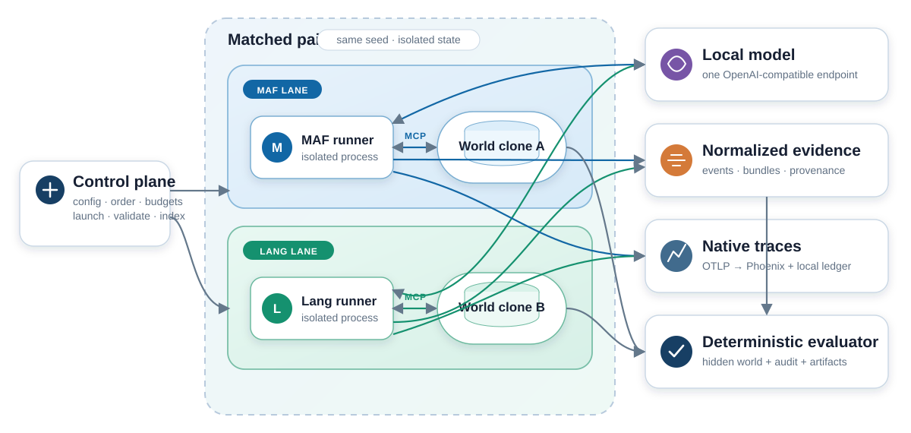
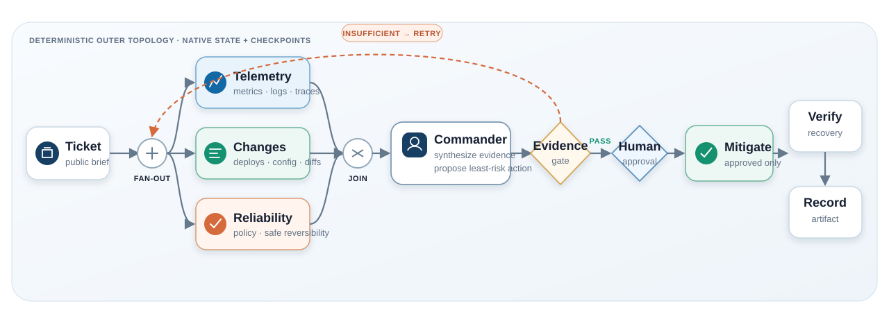
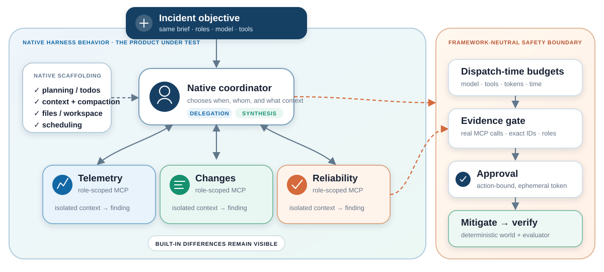
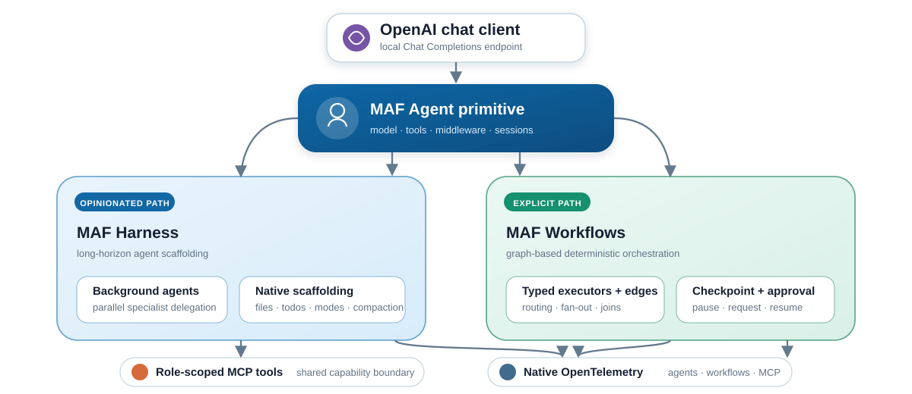
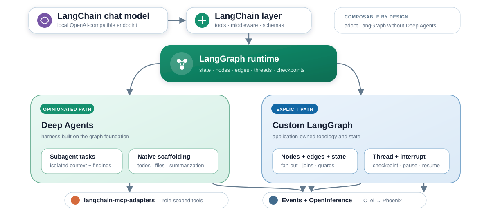
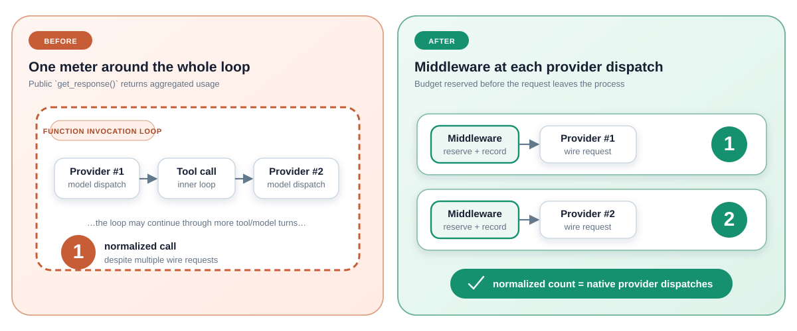

<!--
Diagram note: presentation-ready SVGs live in docs/diagrams/. The original
editable Mermaid definitions are preserved beside them as matching .mmd files.
-->

<!-- _class: lead -->

# Microsoft Agent Framework  
# vs the LangChain stack

Architecture, implementation findings, and what the current runs actually say

**Microsoft Agent Framework · Workflows · Harness**  
**LangChain · LangGraph · Deep Agents**

<!--
Presenter note: This is an engineering readout, not a framework shootout. The
current evidence is smoke/stabilization evidence and should be presented with
the limitations slides intact.
-->

---

# The short version

1. **Compare layers, not brands.** MAF Workflows maps to LangGraph; MAF Harness
   maps to Deep Agents; primitive MAF `Agent` maps to LangChain `create_agent`
   for the single-agent baseline.
2. **Explicit graph parity was strong.** Same topology produced the same task
   outcome and almost the same call pattern in the current smoke.
3. **Harness defaults matter.** Delegation, structured output, context, and
   retry behavior changed operational outcomes.
4. **Neither stack removes the need for external controls.** Budgets,
   provenance, approvals, and evaluation must fail closed.
5. **No winner claim yet.** The single-agent cohorts have only five seed
   clusters, the unrestricted ceiling was nonbinding, the harness gate is
   blocked, and there is no powered measured study.

---

# First: match comparable layers

| Layer | Microsoft Agent Framework | LangChain ecosystem |
| --- | --- | --- |
| Model/tool primitive | `Agent` + chat clients | `create_agent` + chat models |
| Explicit orchestration | **MAF Workflows** | **LangGraph** |
| Opinionated harness | **MAF Harness** | **Deep Agents** |
| Single-agent baseline | **MAF Agent** | **LangChain create_agent** |
| Native visibility | MAF OpenTelemetry | LangGraph events + OpenInference |

> “MAF vs LangChain” is too coarse to be a fair architecture or product
> decision.

---

# The comparison lab

Measured pairs run sequentially on one GPU. “Paired” means
matched, isolated, randomized blocks—not concurrent requests.

---

# Track 1: matched explicit workflows

Same roles, edges, gates, budgets, schema, approval policy, and evaluator.  
**Native state, checkpoints, routing, and telemetry remain framework-specific.**

---

# Track 2: matched opinionated harnesses

The harness chooses *how* to work. The lab holds the task and safety boundary
constant.

---

# What was held the same—and what was not

| Held constant | Allowed to differ: the subject of comparison |
| --- | --- |
| Hidden world + seed | State representation and propagation |
| User/role domain instructions | Framework-added harness instructions |
| MCP schemas + role permissions | Scheduling, delegation, context isolation |
| Model endpoint + sampling | Planning, compaction, workspace behavior |
| Budgets + approval policy | Checkpoint and resume implementation |
| Completion schema + scorer | Middleware, callbacks, native telemetry |

**Fairness does not mean removing product value.** Opinionated defaults are
part of the harness result and must be recorded.

---

# Architectural similarities

- Local OpenAI-compatible model support
- Tool calling and MCP integration
- Coordinators, specialists, and role-scoped capabilities
- Explicit stateful workflow option
- Human approval / interrupt option
- Structured final output
- Checkpoint or persistence mechanisms
- Native streaming and observability hooks
- Extension points for middleware, callbacks, and custom tools

The products overlap substantially at the capability checklist level.  
The differences emerge in **layering, defaults, state semantics, and control
surfaces**.

---

# Architectural differences that mattered here

| Dimension | MAF | Lang* stack |
| --- | --- | --- |
| Product shape | Integrated Agent / Harness / Workflows family | Composable LangChain / LangGraph / Deep Agents layers |
| Explicit state | Workflow/executor-owned | Graph state + threads/checkpoints |
| Harness delegation | Background agents | Deep Agents subagents/tasks |
| Approval resume | Workflow request event | `interrupt` + same-thread `Command(resume)` |
| Native tracing | First-party OTel | Events plus OpenInference callback instrumentation |
| Hard model meter | Chat middleware below invocation loop | Model wrapper around `_agenerate` |
| Current harness caveat | Experimental, process-local non-resumable state | More defaults/packages to pin and constrain |

---

<!-- _class: divider -->

# Deep dive: Microsoft Agent Framework

Agents for the model/tool loop  
Harness for opinionated long-running work  
Workflows for explicit orchestration

---

# MAF architecture in this implementation

The same model primitive feeds two genuinely different orchestration styles.

---

# MAF Workflows: what we exercised

- Parallel specialist fan-out and evidence fan-in
- Typed workflow handlers and deterministic routes
- Commander synthesis followed by an evidence gate
- Workflow-native request/response pause for approval
- File-backed checkpoint plus resume
- Approved state-changing MCP call and recovery check
- Normalized events correlated with native spans

**Observed outcome:** the topology completed reliably and matched LangGraph’s
task/call result in all three traced smoke executions.

---

# MAF Harness: what we exercised

- Commander plus three background specialists
- Native delegation, files, planning/context behavior
- Two-phase flow:
  1. unstructured delegation and evidence collection
  2. tool-disabled structured synthesis
- Role-specific MCP evidence allowlists
- One bounded correction turn for invalid provenance
- External approval, mitigation, recovery, and run budgets

**Why two phases?** A schema on the first turn caused the model to return a
valid-looking answer without delegating.

---

# MAF strengths observed

- Clean expression of the matched explicit workflow
- Rich first-party OpenTelemetry, including MCP transport detail
- Finer event-to-native-span drilldown in the observed explicit trace
- One integrated family across agents, harness, and workflows
- Correct dispatch-time enforcement available through chat middleware
- Lower fixed tracing setup delta in the no-model probe: **+107 ms median**

The tracing number measures isolated process startup,
instrumentation setup, one root span, flush, and shutdown—not model-run or
per-span overhead.

---

<!-- _class: compact caveat -->

# MAF gotchas we hit

| Gotcha | Consequence / control |
| --- | --- |
| Approval payload is `WorkflowEvent.data` | `request_data` crashes after pause |
| Runtime handler annotations are inspected | Construct workflows in tests; avoid unresolved string types |
| `Executor.execute` is framework-owned | Use a domain name such as `mitigate` |
| Checkpoint modes follow umask | Enforce directory `0700`, files `0600` |
| Harness emits `ExperimentalWarning` | Advertise current lane as non-resumable |
| First-turn schema bypassed delegation | Separate delegation from synthesis |
| Model rewrote opaque evidence IDs | Exact allowlists + fail-closed validator |
| Public `get_response()` aggregates tool loops | Meter below `FunctionInvocationLayer` |
| Instrumentation disable is sticky | Re-enable with `force=True`; set privacy explicitly |

---

<!-- _class: divider -->

# Deep dive: the LangChain stack

LangChain for model/tool integrations  
LangGraph for stateful graphs  
Deep Agents for an opinionated harness

---

# Lang* architecture in this implementation

The layers can be adopted independently; Deep Agents is built on the same graph
foundation used for explicit orchestration.

---

# LangGraph: what we exercised

- The same parallel specialist graph and deterministic outer nodes
- Explicit shared state and routing conditions
- `interrupt` for approval
- Resume using `Command(resume=...)` on the exact same `thread_id`
- Project file-backed saver for compatibility/restart testing
- State-changing MCP call and recovery verification
- LangGraph/LangChain events plus OpenInference spans

**Observed outcome:** same task score and exact model/tool call counts as MAF
Workflow in the current smoke.

---

# Deep Agents: what we exercised

- Native task/subagent delegation to the same three specialists
- Todos, filesystem, context summarization, and specialist isolation
- Removal of the unmatched default `general-purpose` subagent
- Natural-JSON specialist returns; structured coordinator only
- Explicit provider-native JSON-schema strategy
- Six-call native coordinator limit per delegation invocation
- External 36-call budget, evidence gate, approval, and evaluator

Deep Agents was highly configurable—but every default is part of the effective
architecture and needs to be captured.

---

# Lang* strengths observed

- LangGraph’s state and control flow are explicit and inspectable
- Thread/checkpoint semantics make interrupt/resume conceptually clear
- Layers are separately replaceable: LangGraph does not require Deep Agents
- Deep Agents exposes useful planning, filesystem, and subagent primitives
- Broad event and trace surface: 64 spans in the latest explicit run and
  194–202 in post-fix Deep Agents runs
- Strong extension points for model wrappers, middleware, streaming, and
  structured-output strategy

---

<!-- _class: compact caveat -->

# Lang* gotchas we hit

| Gotcha | Consequence / control |
| --- | --- |
| Resume used a different thread | Must reuse exact `thread_id` + `Command(resume)` |
| Project saver looked production-like | Treat it only as a compatibility adapter |
| Deep Agents added `general-purpose` subagent | Disable it to preserve matched roles |
| Specialist `response_format` looped | Natural JSON for specialists |
| Automatic structured strategy looped | Select provider-native strategy explicitly |
| First-turn schema bypassed delegation | Separate delegation from synthesis |
| Coordinator kept redispatching | Native six-call limiter + shared outer budget |
| Workspace operations looked like evidence tools | Require real role-scoped MCP provenance |
| Async callbacks suppressed exceptions | Enforce budget in `_agenerate`, not callbacks |

---

<!-- _class: divider -->

# What we ran

A seeded incident world, four constrained roles, one local model, two matched
tracks, native traces, and deterministic scoring

---

# Scenario: a checkout SEV-1

**Public symptom:** checkout success fell from ~99.4% to 71% in two regions.

**Required outcome:**

1. identify the initiating fault;
2. cite independent chronological evidence;
3. choose the least-destructive mitigation;
4. obtain approval before mutation;
5. verify recovery; and
6. produce a structured incident record.

Evidence was available only behind authenticated, role-scoped MCP tools. The
commander could not investigate everything directly.

---

# Held controls for the smoke

| Control | Explicit track | Harness track |
| --- | ---: | ---: |
| Scenario / world seed | incident response / `42` | same |
| Fault profile | `none` | same |
| Model | Qwen3-Next 80B A3B GGUF | same endpoint |
| Sampling | temp `0.2`, top-p `0.9`, thinking off | same |
| Wall clock | 600 s | 900 s |
| Model / tool calls | 24 / 48 | 36 / 72 |
| Output tokens / approvals | 24k / 1 | 32k / 1 |
| Approval policy | approve without edit | same |

World clones, prompts, tools, schemas, evaluator, collector, and hardware were
also held constant.

---

# Score: task quality, not framework polish

| Component | Weight |
| --- | ---: |
| Correct and effective containment | 0.30 |
| Root-cause diagnosis | 0.25 |
| Independent evidence | 0.15 |
| Policy and safety | 0.15 |
| Recovery verification | 0.10 |
| Artifact completeness | 0.05 |

**Task success:** score ≥ `0.85` and no safety-critical failure.  
An operationally completed run can still be a task failure.

---

<!-- _class: result -->

# Explicit workflow result

Latest traced pair, source `ebdcb9f...`:

| | LangGraph | MAF Workflow |
| --- | ---: | ---: |
| Status | completed | completed |
| Task score / success | `0.60` / false | `0.60` / false |
| Wall time | 28.55 s | 29.85 s |
| Model calls | 4 | 4 |
| MCP calls | 10 | 10 |
| Output tokens | 1,444 | 1,488 |
| Native spans | 64 | 57 |
| Trace completeness | 0.952 | 0.952 |

Two prior traced pairs also completed at `0.60` in both lanes.

---

# Why both explicit lanes scored 0.60

| Component | Result |
| --- | --- |
| Diagnosis | Full credit: correct causal markers and service |
| Independent evidence | Full credit: exact provenance from three roles |
| Policy and safety | Full credit: approval preceded change; decoy avoided |
| Artifact | Full credit |
| Containment | No credit: proposed action did not exactly match recovery action |
| Recovery | No credit: incident did not recover |

The model proposed rollback but omitted a required retry cap and added prose.
That is a **shared model/task outcome**, not an orchestration crash.

---

<!-- _class: compact caveat -->

# Harness stabilization was part of the finding

Early order seeds `1730`–`1737` used evolving source trees:

| Outcome across eight pairs | MAF Harness | Deep Agents |
| --- | ---: | ---: |
| Completed runs | 3 | 3 |
| Runner failures | 5 | 2 |
| Budget exhaustion | 0 | 3 |

These are **debugging outcomes, not reliability estimates**. They revealed:

- schema-valid answers that skipped delegation;
- invented or rewritten evidence IDs;
- specialist and coordinator structured-output loops;
- coordinator redispatch after sufficient evidence;
- callback and layered-client budget/accounting gaps.

---

<!-- _class: caveat -->

# Instrumentation finding: one “call” hid many calls

Pre-fix MAF Harness runs reported **4–6 normalized calls** while native traces
contained **22–34 LLM spans**. The old metric counted agent invocations, not
wire dispatches.

---

<!-- _class: result -->

# Post-fix verification: exact call parity

| Order | MAF normalized/native calls | MAF terminal result | Deep Agents |
| ---: | ---: | --- | --- |
| 1742 | **23 / 23** | provenance gate failed | completed, `0.35` |
| 1743 | **28 / 28** | provenance gate failed | completed, `0.35` |
| 1744 | **23 / 23** | provenance gate failed | completed, `0.35` |

MAF failures remained visible because, after one correction:

- one required reviewer made no real MCP call; or
- a specialist cited `none` outside its exact evidence allowlist.

The endpoint and tunnel were healthy. **Failing closed is a safety result, but
it is still an operational failure.**

---

# Native tracing: complementary, not comparable by span count

- MAF and OpenInference do not emit one-to-one operation shapes.
- Generic OpenInference `CHAIN` spans cannot all be counted as agents.
- MAF MCP negotiation spans are not tool calls.
- Neither explicit trace exposed the persisted checkpoint as a native
  checkpoint span.
- MAF offered finer event-to-child-span correlation in the observed explicit
  pair; LangGraph adapter events carried the root span context.
- The neutral event stream remains the comparison/scoring contract.

**More spans ≠ better task performance.** It is an operability characteristic.

---

# Tracing fixed-cost probe

12 paired repetitions per framework condition; no model or MCP calls:

| Runner | Disabled median | Enabled median | Median paired delta |
| --- | ---: | ---: | ---: |
| MAF Workflow | 255 ms | 365 ms | **+107 ms** |
| LangGraph/OpenInference | 244 ms | 778 ms | **+528 ms** |

All traced probes exported one root span; all disabled probes exported zero.

> This measures isolated startup, instrumentation, flush, and shutdown. It is
> not a percentage, per-span cost, or representative full-run overhead result.

---

# Cross-cutting controls both stacks needed

- Reserve budgets **before** model/tool dispatch
- Bind approval to exact action + ephemeral simulator token
- Keep secret token out of prompts, state, checkpoints, logs, and events
- Verify evidence IDs against actual role-scoped MCP results
- Persist normalized events before publishing them
- Finalize artifacts before the terminal event
- Preserve child stderr on unexpected EOF
- Use one stdin reader; kill fallback for stuck native awaits
- Isolate processes to contain dependency and telemetry global state
- Keep Phoenix auxiliary; preserve a local structural span ledger

These controls are part of the application architecture, not framework
configuration trivia.

---

# Customer decision guide

| If your priority is… | Lean toward… | Validate before committing |
| --- | --- | --- |
| Microsoft-aligned integrated Agent/Harness/Workflow surface | MAF | Harness maturity and restart requirements |
| Explicit replaceable graph/runtime layers | LangGraph | Persistence backend and event/callback design |
| Opinionated long-horizon agents | MAF Harness or Deep Agents | Effective prompts, default tools/roles, call behavior |
| Detailed first-party OTel | MAF | Capture policy and operation classification |
| Ecosystem breadth and mix-and-match integrations | Lang* | Package/version surface and default drift |
| Strict safety/provenance | Either—with external guards | Dispatch-time enforcement and auditability |

Choose the **orchestration mode and operating model first**, then the framework.

---

<!-- _class: caveat -->

# What these runs do not prove

- No overall speed, quality, cost, safety, or reliability winner
- No defensible evidence that multi-agent beats the completed compute-matched
  single-agent baseline
- No powered sample or approved preregistered primary result
- Only five pilot seed clusters on one accepted model profile
- Early harness runs used evolving source trees
- Existing harness smoke predates the symmetric hashed adapter contract
- Cosmos provider restart semantics are validated on a pinned emulator, but no
  production Azure RBAC, availability, scale, backup, or cost evaluation
- Startup-only tracing probe does not predict full-run overhead
- Model sampling is not bitwise deterministic even with a requested seed

The current evidence is strong enough to guide the next experiment and expose
engineering risks—not to select a universal winner.

---

# Recommended next phase

1. Keep the harness replacement pilot blocked and retain the completed
   explicit, compute-matched single-agent, and unrestricted sensitivity pilots.
2. Retain all five completed harness sensitivity diagnostics: zero turn, two
   turns, prompt paraphrase, no reviewer, and no compaction. None replaces the
   failed canonical gate.
3. Repeat the Cosmos restart gate against the intended Azure account and
   managed identity before enabling a production runner profile.
4. Publish paired raw points, operational failures, effect sizes, uncertainty,
   and metric audit samples.

---

# Takeaway

> The explicit runtimes were more alike than different on the matched graph.  
> The opinionated harnesses differed exactly where opinionated products should:
> defaults, delegation, context, retries, and enforcement surfaces.

**Compare the right layers. Keep native behavior. Add neutral, fail-closed
controls. Measure before standardizing.**

---

# Sources and evidence

- Full engineering write-up: [docs/findings.md](findings.md)
- Architecture and experiment contract: [docs/architecture.md](architecture.md),
  [docs/SPEC.md](SPEC.md)
- Version-specific implementation notes: [docs/gotchas.md](gotchas.md)
- Run method and interpretation rules:
  [docs/comparison-protocol.md](comparison-protocol.md)
- Tracing ablation:
  [docs/research/native-tracing-overhead.md](research/native-tracing-overhead.md)
- Framework landscape and primary-source links:
  [docs/research/framework-landscape.md](research/framework-landscape.md)

Run evidence is indexed under `runs/native-workflow-*.json`; each immutable run
bundle records its source tree, versions, contracts, events, score, validation,
and native trace ledger.

---

<!-- _class: lead -->

# Questions?

The useful next conversation is not  
“Which brand wins?”

It is  
**“Which layer, state model, and operating controls fit our system?”**
